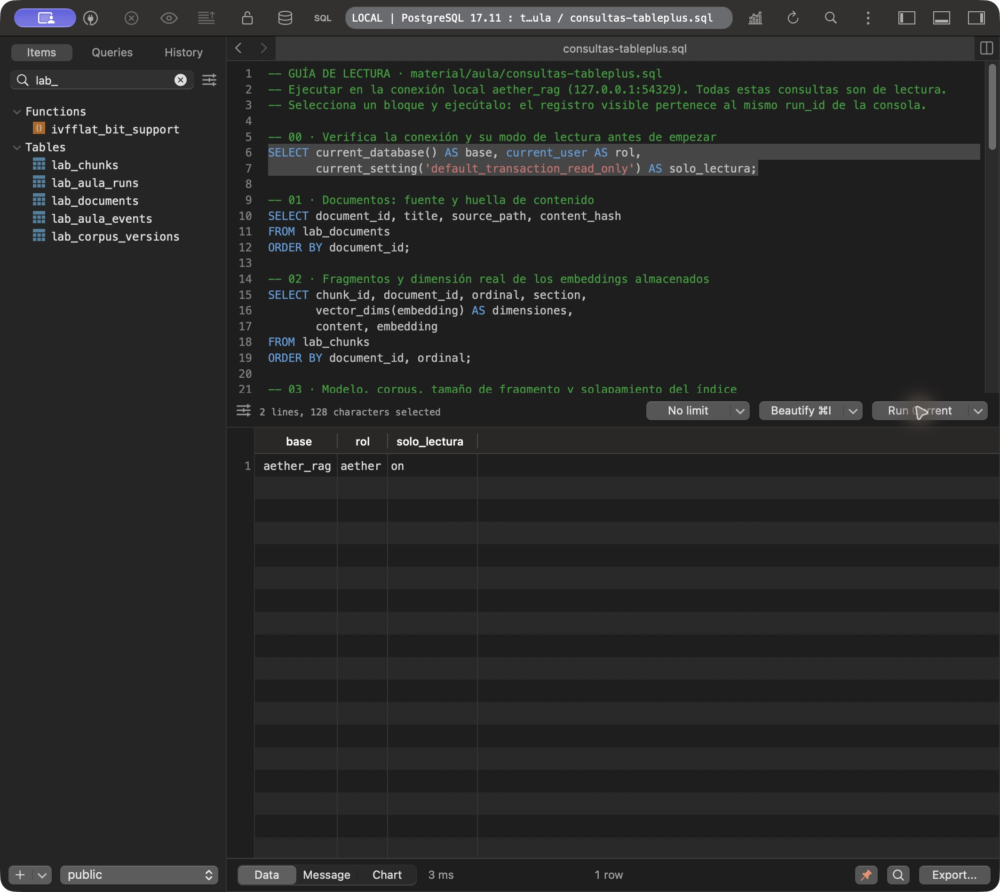
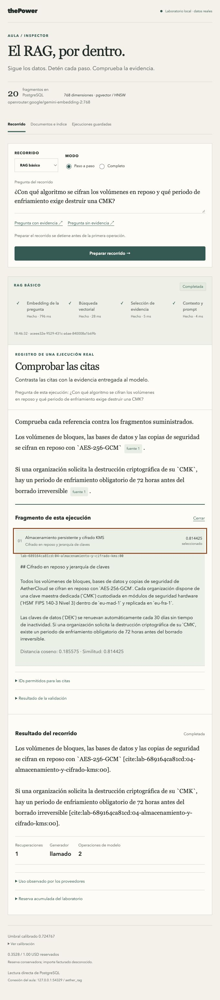

# Aula / Inspector · ensayo real del 23 de octubre de 2026

Implementación local en `/Users/jose/Documents/the-power/3-rag`, sobre `main` (`37ecafb1a432e5b9d201dba0ceebbe6d783c1d2f` antes de estos cambios). La nueva consola se sirve en `http://127.0.0.1:5192/`. Esta entrega es del laboratorio local; no constituye un despliegue del inspector en la web pública.

## Qué se implementó

Tres recorridos reales: ingesta, RAG básico y generación sin documentos. El observador opcional instrumenta los módulos existentes `lab/src/rag-basic.ts`, `lab/src/pgvector-store.ts` y `apps/api/src/lab-models.ts`. El servidor y diario están en `lab/aula/`, la interfaz React en `lab/ui/` y el arranque en `scripts/lab-aula.ts`. No se añade un cliente PostgreSQL al Worker: se conserva Bun.SQL nativo para el laboratorio.

En modo paso a paso se espera antes de operar. El avance debe nombrar la etapa pendiente; un avance repetido no libera la siguiente. El modo completo usa las mismas operaciones. Una pausa durante una llamada se aplica en la siguiente frontera. La ingesta no mantiene una transacción abierta durante una pausa humana. La reconexión SSE solo observa, con secuencias deduplicadas y snapshot; el historial sobrevive al reinicio del servidor sin reenviar llamadas.

El corpus es ficticio (AetherCloud), pero las operaciones ensayadas usan proveedores, SQL y vectores reales. Los datos visibles son entradas/salidas capturadas, no una animación de un resultado preescrito. Las claves se quedan en el servidor. Las tablas `lab_aula_runs` y `lab_aula_events` conservan pregunta, etapas, SQL, parámetros, filas, deltas, consumo y resultado; la reconstrucción del corpus no las trunca.

## Entorno leído de vuelta

- PostgreSQL **17.11**, pgvector **0.8.7**, contenedor `thepower-rag-lab-pgvector`, `127.0.0.1:54329/aether_rag`.
- Diez documentos y veinte fragmentos, `vector(768)`, índice HNSW con distancia coseno. Corpus `lab-689164ca81cd`, perfil `5a2d65a60a2c9f4bc43bbbd7e7a9be89a6275411dc6b10ca13f76c49edbb542c`.
- Embeddings `openrouter:google/gemini-embedding-2:768`; generador `anthropic / claude-sonnet-5-5`; umbral calibrado **0,724767**, validado contra la identidad del corpus/modelo y el conjunto de validación existente.
- Ejecución de los comandos con Bun **1.4.4** en este Mac; el repositorio declara `bun@1.4.2`. No se modificó esa versión declarada.
- Presupuesto acumulado conservado: **1 USD** de límite; **0,3527636 USD** reservados y **60 operaciones** acumuladas después de los ensayos. El importe facturado por el proveedor sigue siendo desconocido. No se borró ni amplió el diario.

## Recorridos reales conservados

Los UUID se pueden abrir en **Ejecuciones guardadas** y cruzar con TablePlus. El [recibo de aceptación](aula-inspector-2026-10-23.json) conserva las comprobaciones dirigidas; los detalles completos están en PostgreSQL y en `lab/.local/aula-<uuid>.json`.

| UUID                                   | Comprobación                                         | Resultado observado                                                             |
| -------------------------------------- | ---------------------------------------------------- | ------------------------------------------------------------------------------- |
| `78e97929-b4e3-4485-8051-f6b59a7a8f5e` | Ingesta paso a paso desde la interfaz                | Diez documentos, veinte embeddings reales y veinte filas leídas de vuelta       |
| `aceee32e-9529-431c-a6ae-840008a1b69b` | Consulta de cifrado paso a paso desde la interfaz    | Cuatro candidatos, un seleccionado; AES-256-GCM y 72 horas con la cita esperada |
| `d78f421d-dc9c-4715-a6d3-80a2bda2b91d` | Pregunta sin evidencia sobre licencias de Windows    | Rechazo antes de generar; `generationCalled: false`                             |
| `12325c04-738b-4a66-9c0e-693e4ee3955c` | Mismo generador con contexto vacío                   | Cero recuperaciones y cero documentos; reconoce la ausencia de información      |
| `074e86b1-0528-4df5-a059-693fe33af483` | Nueva ingesta completa y captura de la lectura final | Veinte fragmentos; cuatro consultas observadas de verificación                  |
| `6a0d02bc-6d33-40a5-bf23-b9de8d5d0a88` | Preparar y cancelar antes del primer paso            | Cancelada; cero llamadas adicionales al proveedor                               |

La consulta positiva seleccionó `lab-689164ca81cd:04-almacenamiento-y-cifrado-kms:00`, similitud **0,814425**, frente a 0,687235 / 0,632308 / 0,626340 de los otros candidatos. Se observaron **24 deltas**, 690 tokens de entrada y 181 de salida del generador, finalización `stop`. La fuente contiene ambos hechos y se abrió desde **fuente 1** en la interfaz. La latencia total del recibo incluye pausas del profesor; las duraciones de cada etapa comienzan después de liberar la pausa.

Se recargó la página durante una pausa conservando UUID y frontera. Tras un cierre ordenado y nuevo arranque del servidor se abrió de nuevo el resultado positivo, su cita y el historial desde PostgreSQL. No se repitieron las llamadas pagadas para verificar la reproducción.

## TablePlus

Se creó la conexión **thePower · Aula RAG · PostgreSQL local** y se abrió [la hoja SQL](../../material/aula/consultas-tableplus.sql). La contraseña no se guardó: **Ask every time**. El bloque 00 devolvió `aether_rag`, `aether`, `on` para `default_transaction_read_only`.

El bloque 04b seleccionó el UUID real de cifrado en la sesión. El bloque 05 mostró sus **47 eventos**, con los mismos textos, vectores, candidatos, prompt y resultado que la consola. Los bloques 05–10 usan siempre esa selección y no mezclan preguntas. Todas las sentencias de la hoja se ejecutaron además con `psql -v ON_ERROR_STOP=1` y sesión de lectura, sin errores; 04b solo conserva una selección en la sesión.

## Verificación de código y persistencia

- `bun install --frozen-lockfile`: sin cambios de dependencias. React y sus tipos reutilizan las versiones exactas ya presentes.
- `bun run check`: formato, lint con tipos y TypeScript del monorepo en verde.
- `bun run test`: **350 tests en 55 archivos**, incluidos ocho nuevos de pausas, doble avance, automático, fallo del diario, origen local, cuerpo HTTP, SSE y deduplicación.
- `bun run build`: build del Worker y la web completado. El arranque de Aula compila su propia interfaz con Bun y se comprobó en el navegador integrado.
- `bun scripts/verify-aula-persistence.ts`: roundtrip real en PostgreSQL con `stages` como array JSONB, resultado como objeto y tres eventos con payload completo. La transacción se revierte: cero llamadas a modelos y ningún ensayo sintético queda en el historial.
- `git diff --check`: sin errores de espacios.

El ensayo descubrió y corrigió la doble codificación de JSONB al pasar JSON serializado a Bun.SQL. Los parámetros del diario se enlazan como texto y después se convierten a JSONB (`::text::jsonb`). Se desenvuelven únicamente los registros del primer ensayo en las dos tablas propias, conservando sus valores. La prueba anterior comprueba la lectura real para que un doble de SQL no oculte esta incompatibilidad.

React Doctor se ejecutó sobre los seis archivos de la interfaz nueva. Se corrigieron la dependencia ajena al efecto, la recreación del formateador y las claves de fragmentos. Su revisión restante señala tamaño/complejidad de dos componentes y el índice de las partes estáticas de una respuesta: ese índice identifica la posición de un segmento del texto, sin estado de formulario que preservar ni reordenamiento. No se desactivaron reglas. El control de tipos/lint del proyecto pasa sin avisos.

## Material y límites de la entrega

El [guion de 60 minutos](../../material/aula/guion-aula.md) incluye preparación, TablePlus, indexación, consulta con fuente, rechazo, comparación sin documentos, reconexión y respaldo. Se actualizaron README, mapa de agentes y decisiones. Los ZIP históricos y las presentaciones no forman parte de esta actualización.

El Aula inspecciona el laboratorio pgvector, no las peticiones de producción. La configuración de `production` sigue usando D1/Vectorize con BGE-M3 de 1024 dimensiones y contexto completo para RAG básico; el perfil `local` configura semántico. La calidad de estas preguntas dirigidas no es una tasa general. Validar ids de citas tampoco prueba por sí solo el apoyo de todas las afirmaciones.

OpenViking permanece pendiente: `workspace-account.sh` no asigna cuenta a este repositorio (salida 1). No se ha adivinado una cuenta ni escrito en otro tenant. La evidencia y las decisiones verificadas se conservan en este checkout.

