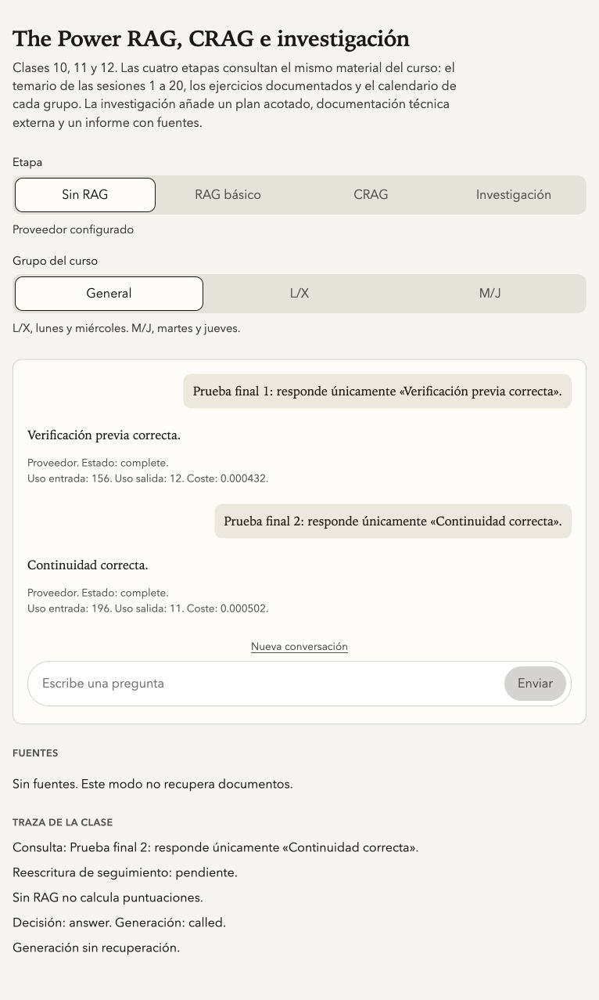

# Turnstile antes del envío — 23 de octubre de 2026

Estado: corregido, comprometido, enviado a `origin/main` y publicado el 23 de octubre de 2026. Código desplegado: `273641f286036650ea728a75ffcdf2063e3362b6`. Versión Cloudflare `dc051851-8cd1-41d0-96f5-21843c62ca4e`, deployment `ef13fc2f-976b-4190-9368-ad71754a162f`, 100 % del tráfico. Las dos preguntas de la comprobación final completaron respuestas reales.

## Causa confirmada en el código anterior

`use-turnstile.tsx` renderizaba con `appearance: "interaction-only"`, pero no indicaba `execution`: Cloudflare ejecutaba el desafío al renderizar. `consumeVerificationToken` entregaba el token anterior y llamaba a `resetWidget()` para pedir el siguiente. Además, el `finally` de `ChatPane.sendQuestion` volvía a reiniciar el widget al acabar el stream. Ambos reinicios podían mostrar interacción cuando el mensaje ya se estaba enviando o su respuesta había terminado.

La apariencia condicional controla la visibilidad, no cuándo se ejecuta el desafío. Los refrescos automáticos por caducidad y error tampoco estaban desactivados. La espera de 20 segundos podía acabar antes de que una persona completara el desafío y los callbacks de error/desmontaje no rechazaban todas las esperas de forma inmediata.

El servidor sí valida Siteverify antes de usar presupuesto, documentos o modelos. El defecto identificado está en el ciclo del navegador.

## Comportamiento implementado

1. Cargar la página prepara la sesión y el script; no crea tokens ni ejecuta desafíos.
2. Enviar adquiere un cerrojo síncrono y comprueba primero la sesión. Si cambió la identidad o la clave pública, reconstruye la configuración y conserva la pregunta para el reintento.
3. Cada petición obtiene su propio widget con `execution: "execute"` y `appearance: "interaction-only"`. Solo Cloudflare decide si hace falta interacción visible. No se comparten ni reutilizan tokens.
4. La pregunta permanece en el formulario. El historial y `POST /api/chat` esperan al callback de éxito. El servidor conserva todas sus comprobaciones.
5. El widget se retira al terminar. `refresh-expired` y `refresh-timeout` están en `never`. `retry: "auto"` permite hasta dos recuperaciones nativas de errores transitorios dentro de la misma verificación y del mismo plazo; solo un token válido desbloquea la petición. Un error definitivo se presenta al usuario y exige una nueva acción.
6. Error, caducidad, cancelación, desmontaje y plazo agotado rechazan la espera y descartan callbacks antiguos. El plazo local del desafío es de 120 segundos; el de sesión es de 10 y el del script, de 15.
7. Chat e investigación comparten el controlador. La investigación incorpora recuperación explícita del script/configuración y estado de verificación. Sus adjuntos y trabajos siguen usando un token independiente por mutación.

La prueba de navegador detectó además que Cancelar podía reutilizarse como botón `submit` dentro del mismo clic al actualizar React. Su manejador ahora previene la acción por defecto antes de cancelar o detener; la prueba confirma que ese clic no abre otro desafío.

La revisión de consola detectó también un bloque del indicador de actividad dentro de un párrafo. Se corrigieron los contenedores de esa línea de estado sin modificar estilos ni animaciones; la prueba de navegador comprueba ahora también los errores de consola.

## Evidencia

| Comprobación                                                       | Resultado                                                                                                                           |
| ------------------------------------------------------------------ | ----------------------------------------------------------------------------------------------------------------------------------- |
| `bun run check`                                                    | Formato, lint y tipos correctos: sin avisos ni errores.                                                                             |
| `bun run test`                                                     | 342 pasan, incluidos ambos modos de recuperación y los reintentos acotados de Turnstile.                                            |
| Pruebas de Turnstile, sesión e investigación incluidas en la suite | 40 pasan.                                                                                                                           |
| `bun run test:entrypoint`                                          | 6 pasan, en 3 suites de workerd.                                                                                                    |
| `bun run build`                                                    | Cliente y Worker compilados con `CLOUDFLARE_ENV=production`; dry-run de Wrangler correcto.                                          |
| `bun run preflight`                                                | Demo local, sin bindings remotos ni llamadas de pago.                                                                               |
| `scripts/verify-turnstile-browser.mjs`                             | 9 escenarios completados en la primera revisión; el ajuste de reintentos añade 3 casos unitarios y comprobación real en producción. |
| React Doctor                                                       | 2 avisos revisados: lectura de sesión en efecto y supuesto reinicio de carga fuera de `finally`.                                    |

La lectura de sesión es un efecto de inicialización con cancelación y plazo; se conserva el patrón sin añadir un almacén de datos. El segundo aviso de React Doctor es un falso positivo: `setPending(false)` está dentro de `finally`, condicionado a que el hook siga montado. No se han suprimido reglas.

Los escenarios de navegador comprueban: ausencia de desafío al abrir; verificación anterior al mensaje con dos envíos simultáneos; cinco minutos de inactividad sin otro desafío; segundo token sin interacción visible; fallo y reintento conservando el borrador; cancelación con callback tardío; cambio de sesión; script bloqueado; configuración inválida; y demo sin cargar Turnstile. Los dos primeros forman un mismo escenario de orden de envío.

El navegador usa Chromium y sustituye únicamente el script de Turnstile y `/api/security`. Los mensajes atraviesan el transporte del AI SDK y el Worker local de demo. Las pruebas de servidor cubren Siteverify con dobles, incluyendo token inválido/reutilizado, hostname, acción y sesión incorrectos, límites y rechazo anterior al presupuesto. Estas pruebas locales por sí solas no acreditan el motor de riesgo de Cloudflare. La comprobación real posterior se documenta a continuación.

## Fallo de suite anterior al cambio

La prueba de calidad construye una referencia con `ragContextMode: "semantic"`, pero deriva la respuesta de la configuración de producción que el commit `482e912` fijó en `complete`. Al ajustar la copia de la respuesta no alinea ese campo; el comparador rechaza correctamente la diferencia.

Se reprodujo el mismo fallo y línea con una exportación de `HEAD`, sin los cambios de Turnstile, en `activation-receipts/turnstile-2026-10-23/baseline`. Sus dependencias instaladas se enlazaron para ejecutar `bun run test scripts/model-quality.test.ts`: 4 pruebas pasaron y 1 falló con el mismo mensaje. Tras la autorización del usuario se corrigió la prueba parametrizando `semantic` y `complete`: cada caso declara su propio modo, comprueba que health lo expone y exige que el comparador rechace el modo contrario. La configuración de producción y el comparador se conservan sin cambios. La suite completa termina con 339 pruebas correctas en 54 archivos.

## Reproducir

Desde la raíz del repositorio, iniciar `bun run dev` y, en otra terminal:

```sh
bun run test apps/web/src/turnstile-widget.test.ts apps/web/src/verification-cycle.test.ts apps/web/src/research-submit.test.ts scripts/chat-protection.test.ts
node scripts/verify-turnstile-browser.mjs
```

El segundo comando requiere Playwright y su Chromium. Si lo proporciona un runtime externo, señalar su directorio de paquetes con `NODE_PATH`. Se admite otro puerto local con `TURNSTILE_TEST_URL`; el script rechaza dominios remotos y cualquier `/api/health` cuyo modo no sea `demo`.

## Documentación consultada con Context7

Biblioteca `/websites/developers_cloudflare_turnstile`, tres consultas sobre ejecución/apariencia, callbacks/refrescos y Siteverify:

- [Configuración del widget](https://developers.cloudflare.com/turnstile/get-started/client-side-rendering/widget-configurations/): ejecución manual independiente de la apariencia, refrescos y callbacks.
- [Renderizado explícito](https://developers.cloudflare.com/turnstile/get-started/client-side-rendering/): `render`, `execute` y ciclo del widget.
- [Validación en servidor](https://developers.cloudflare.com/turnstile/get-started/server-side-validation/): token obligatorio, cinco minutos de vigencia y un solo uso.

## Entrega de memoria

El selector `/Users/jose/.config/openviking/workspace-account.sh` devuelve código 1 sin cuenta para este repositorio. No se ha usado otro tenant ni se ha modificado la infraestructura. La sesión y sus decisiones se conservan en este informe y en `docs/decisions.md`; la escritura y lectura de vuelta de OpenViking quedan pendientes de un mapeo válido.

## Ajuste durante la comprobación real

La primera publicación (`f54c297`, versión `c832582d-f08b-40ee-8947-3f0d7a2e2712`) permitió completar una respuesta real después de un reintento manual. Otro envío volvió a recibir un fallo del widget sin llegar a insertar el mensaje. El código inicial no conservaba el código de error y no permite atribuir esos fallos a una causa concreta.

Se consultó de nuevo Context7: Cloudflare recomienda `retry: "auto"` para fallos transitorios y devolver `false` desde `error-callback` para que el widget se recupere. Se admiten hasta dos recuperaciones para los códigos documentados como reintentables, sin cambiar el plazo ni permitir un POST antes del token. Un tercer fallo, un error de configuración o una cancelación retiran el widget. Se registra únicamente el código público para poder diagnosticar los siguientes intentos.

Fuentes: [reintentos y callbacks](https://developers.cloudflare.com/turnstile/troubleshooting/client-side-errors/) y [códigos de error](https://developers.cloudflare.com/turnstile/troubleshooting/client-side-errors/error-codes/).

## Publicación y verificación final en producción

- Repositorio: `JoseAntonioNuevo/thepower-rag`, rama `main`.
- Commit inicial: `f54c297c2b843bd4171319ea0d91779c69a50a2f`.
- Commit de la revisión final: `273641f286036650ea728a75ffcdf2063e3362b6`, leído también en `refs/heads/main` remoto.
- Versión publicada a las 10:55:46 de Madrid: `dc051851-8cd1-41d0-96f5-21843c62ca4e`.
- Deployment leído de vuelta: `ef13fc2f-976b-4190-9368-ad71754a162f`, única versión al **100 %**. Etiqueta de versión: `273641f`.
- Asset servido por el dominio: `/assets/index-DsSeIhEW.js`, SHA-256 `4b28f9ff634381b5e4ac2856779126b803e6ba77e294e5690c78518055afd01a`, idéntico al build local.
- Bundle del Worker: SHA-256 `ae14408d684c81e030f3e5c51d61b08bbb76fcb84c9ff737ae4770c8b490afee`, conservado. Las 32 variables públicas coinciden con la lectura anterior y los nombres de secretos se conservan. No se publicaron secretos, migraciones ni cambios de recursos.
- `/api/health`: HTTP 200, `execution: real`, las cuatro capacidades `ready`, Sonnet/Sonnet, Haiku en investigación y modo RAG `complete`.

### Navegador y límites de la comprobación

En Brave instrumentado se observó `Verificando antes de enviar…` con la pregunta todavía en el formulario y sin un mensaje nuevo en el historial. Cloudflare devolvió `300030`; se registraron dos reintentos y finalmente el plazo terminó conservando la pregunta. El código documenta este caso como fallo genérico reintentable, sin afirmar una causa concreta del navegador. La comprobación nativa se interrumpió por cambios de foco del usuario; no se modificaron los ajustes de Brave ni la protección.

La comprobación final se hizo en una pestaña aislada del navegador integrado, contra el dominio público y **sin dobles, claves de prueba, manipulación de tokens ni cambios de Turnstile**. Se completaron dos envíos consecutivos con el widget real y Siteverify del servidor:

| Pregunta de prueba                                                  | Respuesta                     | Uso y estimación mostrados                         |
| ------------------------------------------------------------------- | ----------------------------- | -------------------------------------------------- |
| Prueba final 1: responde únicamente «Verificación previa correcta». | Verificación previa correcta. | 156 tokens de entrada, 12 de salida; 0,000432 USD. |
| Prueba final 2: responde únicamente «Continuidad correcta».         | Continuidad correcta.         | 196 tokens de entrada, 11 de salida; 0,000502 USD. |

Ambas respuestas indican `Proveedor. Estado: complete.`. Cloudflare resolvió la comprobación sin exigir interacción manual: no se mostró un desafío innecesario y el widget se retiró tras los envíos. No hubo avisos ni errores de consola en esta pestaña. La rama que exige una interacción humana no se forzó en producción; su orden anterior al POST está cubierto por la regresión local.

Se dejó la página en reposo desde `2026-10-23T09:05:37.597Z` hasta `2026-10-23T09:11:02.431Z`: **324,834 segundos**, más que los cinco minutos de vigencia del token. Permanecían exactamente dos preguntas, el borrador vacío y el contenedor de Turnstile sin contenido. No reapareció ningún desafío ni se inició otro envío.



### Contador y reservas

D1 antes de la comprobación final: 116 turnos, `reserved_usd=-43.14961649999998`. Después: 118 turnos, `reserved_usd=-42.84961649999998`. Diferencia: **dos turnos y 0,30 USD de reserva**, igual al peor caso de dos peticiones sin RAG. Los fallos de Turnstile no añadieron turnos. Contando la primera respuesta de la publicación inicial, toda la sesión añadió tres turnos y 0,45 USD de reserva.

La fila ya tenía un valor negativo antes de este trabajo; no se modificó manualmente ni se amplió el tope. Esta lectura sirve para comprobar el incremento del ensayo, no se presenta como saldo disponible ni factura. Las estimaciones de tokens tampoco son cargos conciliados del proveedor.

Recibos locales sin secretos: `activation-receipts/turnstile-2026-10-23/{deployment-final.json,version-final.json,live-final.json,retry-build-hashes.json,budget-delta.json,final-two-successes.txt,idle-proof.json,final-after-expiry.txt}`. Los recibos de las revisiones anteriores se conservan para distinguir el ensayo fallido del resultado final.
