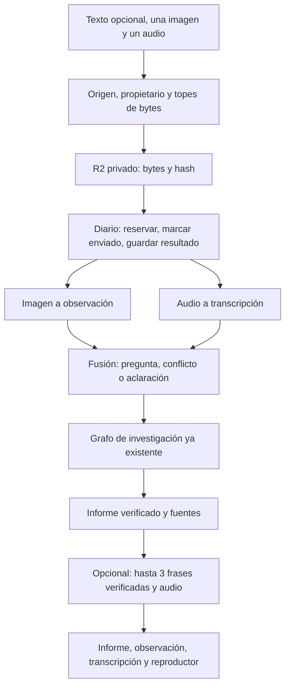

# Investigación multimodal, fase 3 de S12

La implementación multimodal se cerró el 10 de octubre de 2026; su publicación de infraestructura y Worker se hizo el 11 de octubre y está descrita en `docs/s12-cloud-deployment.md`. La fase añade imagen, audio corto y una respuesta hablada opcional sobre el mismo grafo de las fases 1 y 2. La verificación extractiva del informe no cambia. Este texto describe la implementación de esta aplicación. No afirma que la organización del curso haya aprobado un enunciado nuevo.

La fase 1 está en `docs/s12-research-phase1.md`. La fase 2 está en `docs/s12-research-phase2.md`. El RAG básico con `RAG_CONTEXT_MODE=complete` sigue leyendo los fragmentos autorizados en D1. No es una recuperación vectorial top-k. La variante semántica y el CRAG conservan su camino.

## Qué se reutiliza

- Contratos, evidencia y verificador extractivo de la fase 1.
- Conversaciones con propietario firmado, checkpoints en D1, Workflows, diario de operaciones y cuenta `research_accounts` de la fase 2.
- El mismo grafo: validar, plan, curso, herramienta, búsqueda, selección, lectura, evaluación, decisión, una ronda de seguimiento, síntesis, verificación y cierre.
- Los topes de texto: 3 subpreguntas, 2 rondas, 4 búsquedas, 6 lecturas, 5 llamadas de modelo de investigación y 120 segundos. Percepción y voz no se esconden dentro de esas 5 llamadas. Entran en el mismo plazo y no lo reinician al recuperar.

## Recorrido

La imagen aporta el texto observado. El audio aporta la petición. Ninguno de los dos es evidencia del curso ni de una página leída. Esas observaciones quedan en el turno de la conversación, acotadas y sin los bytes, para que una pregunta posterior pueda referirse a ellas. No se convierten en evidencia del curso.

El guion de prueba elige `sufficient-first-round` una sola vez, para el plan, la recuperación del curso, la búsqueda, la evaluación y la síntesis, cuando la pregunta fusionada contiene a la vez `expected 1024, got 768` y la frase de haber cambiado el modelo de embeddings. No hace falta marcar el guion en la pantalla. Un archivo que el guion no conoce no recibe esa respuesta. La huella de la petición del cliente no cambia por esa resolución.

## Entrada y fusión

Cada trabajo admite como mucho una imagen y un audio.

- Imagen: PNG o JPEG baseline. La admisión decodifica el contenido antes de guardarlo y antes de llamar a un proveedor. No cambia los bytes ni el hash. Tope 1,5 MB y lado entre 8 y 1.600 px. Se rechazan SVG, HTML, una cabecera MIME que no coincida con el contenido y un archivo truncado o mal formado. `unknown-square.png` sigue siendo un PNG válido: el guion dice que no lo conoce, y eso no es un rechazo por archivo mal formado.
- Audio: PCM WAV, 16 kHz, mono, 16 bit, entre 0,2 s y 30 s. Tope 1 MB. La duración sale del chunk `data`, no del navegador.

Un PNG exige firma, trozos con longitud y CRC, IHDR primero, IDAT contiguos, IEND vacío al final del archivo, color y profundidad legales, compresión y filtro de cabecera a cero, y entrelazado 0 o Adam7. Además se infla el IDAT con `DecompressionStream("deflate")`, que aquí es zlib. La salida tiene que medir exactamente las filas anunciadas, filtro incluido, y cada byte de filtro tiene que estar entre 0 y 4. El tope de esa salida es 20.500.000 bytes, suficiente para 1.600 × 1.600 en RGBA de 16 bit. Si la inflación pasa de ese tamaño o del tamaño anunciado, se cancela la lectura. Un IDAT de un byte con CRC correcto no entra. Esta comprobación no reconstruye los píxeles ni verifica el filtro Paeth.

Un JPEG exige SOF0 de precisión 8, tablas de cuantización y Huffman, y un SOS de selección espectral 0, 63, 0. Se decodifica cada MCU, como máximo 40.000, incluido un `0xFF 00` dentro del escaneo. Al terminar, el siguiente marcador tiene que ser EOI y no puede sobrar nada. Un JPEG progresivo u otro SOF que no sea baseline se rechaza: no se decodifica. No se reserva un mapa de bits. Que existan bytes entre SOS y EOI no basta. El archivo de 31 bytes con un escaneo `0xFF 11` no entra. `scan-stuffed-ff.jpg` es un JPEG baseline de 48×40 cuyo escaneo sí contiene `0xFF 00`.

La observación de la imagen separa el texto leído, una nota derivada de ese texto y si la lectura es incierta. La transcripción guarda el texto, el identificador del archivo y los metadatos que el proveedor entregue. No se inventa una confianza.

Si falta intención, si la imagen y el audio discrepan en `expected` / `got`, o si un archivo falla, el trabajo termina en aclaración o error visible. No sigue como si no hubiera habido adjunto. Un texto dentro de la imagen no cambia el grupo, el presupuesto, las herramientas ni el propietario.

La pregunta del grafo sigue teniendo 2.000 caracteres. La fusión no recorta un prefijo ni da por buena una pregunta porque haya sobrevivido algo de cada modalidad. El texto escrito, la observación y la transcripción entran enteros, o el trabajo pide acortar y no planifica ni busca. La memoria de turnos anteriores se reduce solo después, y solo si la pregunta actual ya cabe. Un punto suspensivo no demuestra que lo omitido fuera irrelevante. La observación y la transcripción ya leídas se conservan en el medio y en el turno.

El ejemplo de clase junta la captura `expected 1024, got 768` con el audio en español que pide investigar el fallo tras cambiar el modelo de embeddings. Las cifras no se invierten.

## Voz

«Generar voz» nace desmarcado. Con él activo, el texto hablado tiene como máximo 3 frases y 600 caracteres. Sale de cláusulas que ya pasaron el verificador y de frases fijas de estado: parcial, aclaración, rechazo, error o interrupción. Si no hay una cláusula que se pueda leer tal cual, la voz dice que hay que consultar el informe. No hay un resumen libre después de la verificación.

El audio generado se guarda como artefacto del trabajo. Volver a consultar, recargar o descargar no reserva otra vez ni llama al modelo. No hay reproducción automática. Si la síntesis falla de forma conocida, el informe permanece y la pantalla dice que la voz falló. Si el cargo queda ambiguo, el trabajo pide conciliación, el informe sigue legible y el total monetario no se da por cerrado.

La salida de voz admite como máximo 1 MiB en todas las representaciones soportadas: bytes directos, ArrayBuffer, base64, objetos con arrayBuffer y cuerpos en streaming. El base64 se acota antes de decodificar y una respuesta con cuerpo se lee como flujo acotado. Una salida mayor no se publica ni se persiste como audio; el resultado conserva el informe y muestra el fallo de voz.

## Dónde se guarda

| Dato                                                      | Dónde                                                           |
| --------------------------------------------------------- | --------------------------------------------------------------- |
| Bytes de imagen, audio y voz                              | R2 `RESEARCH_MEDIA`, clave emitida por el servidor              |
| Hash, MIME, tamaño, dimensiones o duración, texto acotado | D1 `research_media_assets`                                      |
| Voz pedida e identificadores del trabajo                  | D1 `research_job_inputs`                                        |
| Informe                                                   | Resultado del trabajo o artefacto de informe, como en la fase 2 |
| Checkpoints                                               | Siguen sin bytes, sin bindings y sin base64                     |

La vista previa y el audio se sirven por `GET` y `HEAD /api/research/media/:id`, con el propietario, `nosniff`, nombre seguro y `Cache-Control: private, no-store`. `Range` responde 206. Esas rutas no infieren.

Un archivo sin trabajo y con más de 24 horas puede borrarse en la retención. No se borra un medio de un trabajo activo, recuperable o sin conciliar, ni se pone a cero la cuenta al borrar un artefacto.

## Diario, recuperación y dinero

Visión, transcripción y voz tienen identidades propias. La huella incluye el hash de entrada y el modelo o la voz. El diario reserva antes de enviar, marca que la llamada puede haber salido y guarda el resultado antes de completar. Un resultado completado se reutiliza. Un envío sin resultado, o uno cuya espera local se cortó, no se reenvía. El arrendamiento impide que un ejecutor viejo publique el éxito.

La espera de cada medio compite con la cancelación y con el tiempo que queda del plazo de 120 segundos. Si el adaptador ignora la señal, la espera local termina igual. Eso no demuestra que el proveedor haya cancelado el trabajo ni el cargo: lo ya enviado queda desconocido y un resultado que llegue después no se publica como éxito. No empieza otra llamada de medios ni el grafo cuando el plazo ya se agotó. Si la voz falla o queda ambigua, el informe verificado se conserva.

La instantánea nueva es `research-prices-v3`. Guarda las tarifas de texto de la fase 2, la visión, el minuto de audio, el carácter de voz y el proveedor de búsqueda. Los trabajos antiguos `research-prices-v1` y `research-prices-v2` se interpretan como Firecrawl y se leen sin recalcular; una reanudación con una configuración distinta de la guardada queda detenida. Esas tres operaciones no pueden reservar cero: si la instantánea no las tarifa, no se envían.

Reservas, con las tarifas publicadas usadas aquí:

- Visión: tokens visuales `ceil(ancho / 28) × ceil(alto / 28)`, más 2.000 tokens de prompt y 1.800 de salida, a 0,10 y 0,50 USD por millón. La llamada usa ese mismo tope de 1.800 tokens de salida. El peor caso admitido es 1.600 × 1.600.
- Transcripción: 0,00051 USD por minuto de audio, la cifra más alta de las dos publicadas, prorrateada por la duración validada.
- Voz: 0,030 USD por 1.000 caracteres, reservando el tope de 600 caracteres.

El tope del trabajo se reserva antes de ejecutar y suma solo los medios que el trabajo admite. La cuenta sigue en microdólares enteros y separada de `public_budget`. Los tokens que devuelve el modelo no son un importe. El USD que sale de las tarifas publicadas de Haiku se guarda como estimación, con esa procedencia, y no como USD informado por el proveedor. Si falta el uso de entrada o de salida, la cifra parcial no cierra el cargo ni el total. Una estimación no libera la reserva. Un importe que el proveedor comunica como dinero sigue siendo consumo informado. Los créditos siguen sin convertirse en un total. Una operación ya completada no se reenvía solo para conocer el precio. Si Workers AI no devuelve un importe, el cargo queda desconocido y la reserva no se convierte en cero. Cancelar en local no demuestra que el proveedor no haya cobrado. Un resultado antiguo con `kind: "reported"` y una instantánea `research-prices-v1` o `v2` se leen como se guardaron. No se recalculan.

El SDK de visión usa `maxRetries: 0`. Esta capa no reintenta Whisper ni Aura. El binding de Workers AI no expone un interruptor de reintento: no añadimos un bucle, y no podemos afirmar que la plataforma nunca reintente por su cuenta.

## Guion y modo real

En `bun run dev:research` la percepción está ligada al hash de los archivos de `apps/api/fixtures/media/`. Un archivo desconocido dice que el guion no lo conoce. No finge haberlo leído. La voz de ese modo es un tono WAV generado en local, y la pantalla lo dice. El texto hablado sí sale del informe verificado.

En real, la imagen usa Claude Haiku 5.5 por la API de Anthropic ya configurada, porque su ficha dice «texto e imagen hacia texto». Otro modelo no se sustituye en silencio. El audio usa `@cf/openai/whisper-large-v3-turbo`. La voz usa `@cf/deepgram/aura-2-es`, locutor `aquila`, MP3. Hace falta `RESEARCH_MEDIA`, el binding `AI` para audio y voz, y la autorización de gasto de la investigación. Si falta algo, la petición que necesita ese medio responde 409 y no cae al guion. El texto sin medios sigue disponible aunque la voz no esté configurada. Construir los adaptadores y el preflight no llama a la red.

El usuario autorizó un presupuesto separado de hasta 1 USD total y 0,25 USD por trabajo. Esa autorización permite la configuración real, pero no convierte una prueba local en evidencia de calidad. Hay cuatro niveles de evidencia y no dicen lo mismo:

- Guion: la ejecución de prueba con los archivos del aula, en la base local y en workerd. El informe, las páginas y las fuentes son los del guion `sufficient-first-round`. No miden un modelo.
- Dobles de los adaptadores reales: `anthropicImage`, `workersTranscript` y `workersSpeech` se ejercitan con el doble del SDK y un binding de Workers AI simulado. Cubren la petición, `maxRetries: 0`, la cancelación, la salida inválida y la procedencia del coste. No hay red ni cargo.
- Persistencia local: workerd con D1, Workflows y R2 emulados. Sobrevive a reiniciar el proceso. El audio reproducido es el tono WAV local.
- Proveedores en vivo: parcialmente preparado, calidad sin verificar. Se publicaron los recursos privados de D1 y R2, las migraciones, el Workflow y el secreto Tavily. No se ha hecho una llamada de pago a Tavily, Claude, Whisper ni Aura. No se afirma calidad de búsqueda, visión, transcripción ni voz neural.

Las correcciones del 11 de octubre de 2026 añaden regresiones locales, no una verificación en vivo. La fusión del texto de 969 caracteres y la transcripción de 981 que termina en `ERROR_AUTH_401` pide acortar y deja la pregunta vacía. Una petición o una negación al final del texto o de la transcripción se conserva entera o detiene el recorrido. Si la pregunta actual no cabe, el grafo no reserva plan, búsqueda, lectura, curso, herramienta ni síntesis; la identidad y la clave de idempotencia no cambian. Un PNG de 58 bytes con IDAT inválido y un JPEG de 31 bytes con escaneo inválido responden 400, no crean un activo y no reservan una operación. El PNG y el JPEG del aula, y `scan-stuffed-ff.jpg`, siguen siendo válidos.

En la pantalla pública, cada subida y el alta del trabajo piden una verificación nueva. Un token de Turnstile no se reutiliza.

## Referencias usadas

- [Claude Haiku 5.5](https://platform.claude.com/docs/en/models/haiku-5-5/overview): entrada de texto e imagen, 0,10 / 0,50 USD por millón de tokens hasta 100.000 tokens de prompt. Consultado el 10 de octubre de 2026.
- [Vision](https://platform.claude.com/docs/en/build-with-claude/vision): PNG y JPEG, tokens visuales por parches de 28 px, modelos 4.7 y posteriores con borde largo de 2.576 px y 4.784 tokens visuales.
- [whisper-large-v3-turbo](https://developers.cloudflare.com/workers-ai/models/whisper-large-v3-turbo/): audio, `task` y `language`. La ficha del modelo lista 0,00051 USD por minuto y la tabla de precios lista 0,0005. La reserva usa 0,00051.
- [aura-2-es](https://developers.cloudflare.com/workers-ai/models/aura-2-es/): texto, locutor `aquila` por defecto, salida de audio. 0,030 USD por 1.000 caracteres.
- AI SDK `ai` 7.0.127 y `@ai-sdk/anthropic` 4.0.78: parte `file` con `mediaType` de imagen y `maxRetries: 0`.

## Qué falta para darlo por verificado en vivo

La infraestructura remota y el secreto Tavily están preparados. Aún no hay llamada pagada a Tavily, Claude, Whisper o Aura, así que no se ha medido la calidad de búsqueda, visión, transcripción ni voz neural. El tono local no es la voz de Aura. La clase puede usar el perfil de guiones sin consumir el presupuesto de 1 USD.

## Guía de clase, 90 minutos

Perfil: `bun run dev:research` y `http://127.0.0.1:5191/`. Grupo M/J. Etapa Investigación.

1. Minutos 0-15. Recordar el camino Sin RAG, RAG básico, CRAG e investigación. El RAG básico de este corpus lee los fragmentos autorizados. La investigación sigue siendo nuestro grafo, no un agente gestionado de Deep Research: así se ven el plan, las fuentes, el rechazo de una paráfrasis y el presupuesto.
2. Minutos 15-35. Texto solo, con el guion de evidencia suficiente. Cerrar la página y volver: el informe sigue ahí. Enseñar que la ejecución terminada y el informe completo son cosas distintas.
3. Minutos 35-60. Adjuntar `apps/api/fixtures/media/dimension-mismatch.png` y `embedding-request.wav`. Marcar «Generar voz». Enviar sin escribir la pregunta. La imagen debe mostrar `expected 1024, got 768`. La transcripción debe pedir investigar el cambio de embeddings. El informe cita el curso o las páginas de prueba. La voz lee una frase de ese informe, o dice que hay que consultarlo, y el reproductor suena sin arrancar solo. Recargar y comprobar que siguen el informe, la observación y el audio.
4. Minutos 60-75. Fallo controlado: repetir el envío cambiando la imagen por `unknown-square.png`, que es un PNG válido. El guion dice que no conoce el archivo. No aparece la observación de 1024/768 para esa imagen. Un PNG o JPEG que no se puede decodificar se rechaza en la subida, con un aviso, y no entra en el trabajo. Si el texto escrito y las lecturas no caben en 2.000 caracteres, la pantalla pide acortar y no presenta un informe de una pregunta recortada. Abrir otra conversación y comprobar que no arrastra la vista previa ni el audio de la anterior.
5. Minutos 75-90. Enseñar la configuración real sin ejecutarla: `RESEARCH_MEDIA`, Haiku 5.5 para la imagen, Whisper y Aura-2 es. El preflight no llama al proveedor. Quien no tenga presupuesto usa el guion y deja escrita esa configuración.

Criterio de aceptación para el alumno: explica de dónde sale cada cifra, distingue la entrada del alumno de la evidencia, señala una fuente del informe, reproduce la voz o lee su texto, y describe el fallo del archivo desconocido sin tratarlo como una lectura del modelo.

Los archivos de ejemplo se generaron en local el 10 de octubre de 2026. La imagen salió de Pillow. El WAV salió de `say -v Mónica` a 16 kHz. Su procedencia está en `apps/api/fixtures/media/manifest.json`. No miden un modelo.
