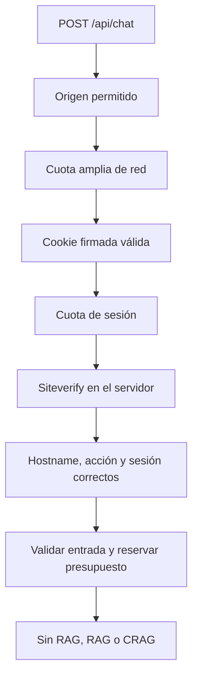

# Proteger un chat o RAG publicado

Implementado en https://rag-thepower.josenuevo.dev el 3 de octubre de 2026. Este bloque puede explicarse en 5–8 minutos dentro del apartado de incidencias y publicación de S10, y retomarse en S11 al hablar de llamadas y presupuesto.

## Qué protege cada control

| Control            | Qué decide                                                        | Implementación de esta demo                                              |
| ------------------ | ----------------------------------------------------------------- | ------------------------------------------------------------------------ |
| Turnstile          | Si la verificación anti-bot de esta petición es válida            | Managed, hostname exacto, acción `course-chat`, sesión asociada al token |
| Cuota de sesión    | Si un mismo navegador está enviando demasiadas preguntas          | 6 peticiones por 60 segundos; sesión anónima firmada                     |
| Cuota amplia de IP | Si una red está enviando demasiadas peticiones o creando sesiones | 120 peticiones por 60 segundos, incluyendo la preparación de sesión      |
| Presupuesto        | Si queda margen para el coste del peor caso del turno             | Reserva condicional en D1 y clave dedicada limitada de OpenRouter        |
| Contratos y grafo  | Si la entrada y el recorrido son válidos                          | Límites de tamaño, scope, búsquedas, reformulaciones, salida y plazo     |

Los límites de peticiones son ejemplos para este prototipo. Un CRAG puede hacer varias llamadas de modelo por pregunta. En una aplicación con login se debe usar el identificador de usuario validado por el servidor para la cuota principal; no confiar en un userId enviado por el navegador.

Una sesión anónima no identifica a un alumno. Turnstile permite mantener una demo pública y reduce el abuso automático. Para que solo entren alumnos hay que añadir autenticación y autorización, o Cloudflare Access con la política apropiada.

## Recorrido de una petición

El servidor ejecuta estos controles antes de acceder al presupuesto, a los documentos o al modelo. No basta con desactivar el botón de enviar: un cliente puede llamar a la API directamente.

## Turnstile explicado paso a paso

1. El backend entrega la site key pública y crea una cookie anónima `Secure`, `HttpOnly`, `SameSite=Strict`, sin almacenar una identidad personal. Su firma impide modificar el identificador de sesión para saltarse una cuota.
2. React prepara el script oficial sin ejecutar desafíos. Al pulsar Enviar renueva primero la sesión y crea un widget con `execution: "execute"` y `appearance: "interaction-only"`. La acción es `course-chat` y `cData` lleva la sesión vigente.
3. El cliente ejecuta la verificación y conserva el borrador. Solo muestra el widget si Cloudflare requiere interacción. Hasta recibir el token no inserta la pregunta en el historial ni hace el POST. Después añade el token a la cabecera `x-turnstile-token`; no entra en mensajes, prompts, fuentes ni trazas.
4. El Worker llama a Siteverify con la secret key privada y el token. Comprueba `success`, el hostname exacto, la acción y la sesión (`cdata`). Un fallo o timeout bloquea el chat.
5. Cada token caduca a los cinco minutos y solo se puede validar una vez. El widget se retira al terminar el intento, tanto si tiene éxito como si falla. El siguiente desafío espera a una nueva acción del usuario; no hay renovación automática después de enviar ni mientras llega la respuesta. No se guarda el token en localStorage.
6. La secret key solo está en el entorno privado del servidor. La site key puede estar en el navegador. No proyectar ni subir `.dev.vars.production` ni el valor de los secretos.

Este orden del navegador se corrigió, publicó y verificó en producción el 23 de octubre de 2026. La [evidencia del cambio](../../docs/evidence/turnstile-before-send-2026-10-23.md) distingue las pruebas locales del servicio publicado.

La sesión de esta demo se renueva con la actividad y dura treinta minutos. Cambiar de etapa o cohorte no cambia deliberadamente su identidad ni elimina su cuota.

## Rate limit y presupuesto

Se usa el binding nativo de Workers, con dos namespaces y prefijos de clave exclusivos de este proyecto. Para la red, la clave contiene un HMAC de la IP entregada por Cloudflare; no se registran IPs en claro. Las respuestas 429 incluyen `Retry-After: 60`.

Los contadores de este binding son locales a una ubicación de Cloudflare y eventualmente consistentes. Un pico puede permitir alguna petición adicional. No sirven como contabilidad exacta global. D1 mantiene el presupuesto con una actualización condicional y OpenRouter mantiene el límite total de la clave.

Si el usuario supera una cuota, la interfaz muestra que debe esperar. Si falla la verificación, permite reintentar y obtener un token nuevo. No se activa un modo sin protección para continuar en producción. El respaldo offline sigue disponible para la clase.

## Demostración breve en clase

1. Abre el dominio y envía una pregunta de RAG cuando el botón esté habilitado. Turnstile verifica en segundo plano y solo muestra el reto si Cloudflare pide interacción. Muestra que la cita y la traza siguen funcionando.
2. Explica la separación de site key pública y secret key privada usando nombres de variables, nunca sus valores privados.
3. Enseña el orden de comprobaciones en `apps/api/src/chat-protection.ts` y la llamada dentro de la ruta de chat en `apps/api/src/app.ts`.
4. Muestra el resultado ya guardado de la prueba negativa: sin origen válido, sin cookie, cookie modificada, sin token y token inventado devolvieron 403. Al superar la cuota de sesión se observó 429. El presupuesto y el contador de turnos en D1 no cambiaron.
5. No lances una ráfaga durante el directo: puede consumir la cuota del profesor o de una red compartida. Usa la evidencia preparada.
6. Pregunta al grupo qué cambiaría con un login: cuota por usuario autenticado, roles y permisos para fuentes, además del presupuesto.

## Criterios para los proyectos del alumno

Para un proyecto que exponga un chat de pago públicamente, comprobar:

- Validación del token en el servidor, con hostname y acción correctos.
- Token nuevo después de uso o caducidad y errores comprensibles.
- Cuota del servidor sobre un identificador fiable, y consideración de redes compartidas.
- Rechazos antes de las llamadas de pago, con prueba de que no se consumió el modelo.
- Secretos fuera del frontend y del repositorio.
- Límites de entrada, salida, reintentos, tiempo y presupuesto.
- Autorización sobre los documentos cuando el corpus no sea público.

Esta checklist añade criterios técnicos de publicación. No cambia la rúbrica ni el encargo oficial de The Power, ni obliga a usar Cloudflare si el alumno elige otro proveedor. La práctica offline no necesita un CAPTCHA ni servicios remotos; tiene que indicar su alcance.

## Fuentes oficiales

- [Validación de Turnstile en el servidor](https://developers.cloudflare.com/turnstile/get-started/server-side-validation/).
- [Renderizado del widget y ciclo de vida](https://developers.cloudflare.com/turnstile/get-started/client-side-rendering/).
- [Rate limiting de Workers: configuración, alcance y precisión](https://developers.cloudflare.com/workers/runtime-apis/bindings/rate-limit/).
